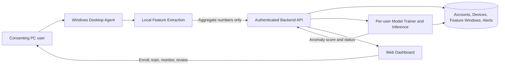
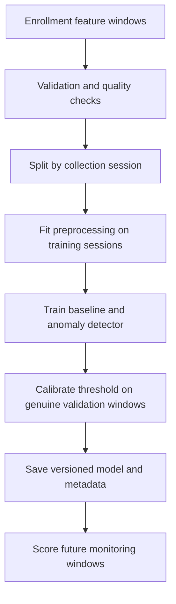

# Inquisitor

## Continuous Behavioral Authentication for Windows PCs

**Project type:** Cybersecurity, behavioral biometrics, anomaly detection, desktop software, full-stack web application  
**Target event:** Hack The Nest 2026 (24-hour hackathon)  
**Potential primary track:** Mind and Machine (subject to organizer judging criteria)  
**Status:** Original project proposal; [architecture decisions](docs/architecture.md) supersede its open stack options
**Target platform:** Windows PC only for the hackathon MVP; no phone, embedded-controller, or browser-only input collector

---

## 1. Executive Summary

**Inquisitor** is an opt-in, continuous authentication system that learns how a particular person normally interacts with their Windows computer. A small desktop application runs in the background and measures *keyboard input behavior*—for example, how long keys are held, how quickly successive keystrokes occur, how consistently the person types, and how often they pause. It does **not** record what keys produce, the words being typed, passwords, or the text displayed on screen.

The user creates an account in a web application, links their PC, and completes an enrollment period. During enrollment, the Windows agent converts activity into small numerical feature summaries and sends those summaries to a backend. The backend trains a user-specific machine learning model. During subsequent normal PC use, the desktop agent periodically sends new summaries. The backend scores these against the enrolled user's baseline and returns a risk assessment. The web dashboard shows monitoring status, authentication confidence trends, and alerts when behavior deviates significantly from the baseline.

**Primary question:** *Does the current input behavior resemble the enrolled user's usual behavior, or is it sufficiently unusual to warrant re-verification?*

**Important distinction:** Inquisitor detects **behavioral anomalies**. It should not claim to know which other person used the computer, conclusively prove an account takeover, or replace strong authentication such as passwords, passkeys, or MFA. Changes in fatigue, injury, keyboard, task type, and environment may legitimately alter typing patterns.

### One-sentence pitch

> Your password proves who logged in. Inquisitor checks whether the person still using the PC behaves like you—without reading what you type.

### Why this is a compelling hackathon project

- It combines **a real Windows background agent**, a **web application**, a **backend API**, and **a model trained during the event**.
- Judges can participate: enroll one person, test their activity, and then have a second person use the same PC.
- Training is based on data collected during the hackathon, not simply on an external AI API.
- It has a clear privacy design: **timing statistics, not keystroke content**.
- It could become a useful security research prototype beyond the hackathon.

---

## 2. Goals and Non-Goals

### Goals

1. Monitor keyboard behavior on **one opted-in Windows PC** while the agent operates in the background.
2. Extract behavioral features locally from key press/release *timings* and aggregate them into windows.
3. **Never store or transmit actual characters, words, passwords, key names, key codes, or ordered key sequences.**
4. Let users register, log in, pair a Windows agent, enroll a model, and view results in a website.
5. Train a **per-user, per-device anomaly detection model** from the user's own enrollment data.
6. Score incoming activity against the enrolled baseline and record meaningful anomalous periods.
7. Make alerts understandable and manageable, with a visible pause/stop control and explicit consent.
8. Show credible evaluation metrics and a live real-user-versus-different-user demonstration.

### Non-goals for the 24-hour MVP

- Replacing Windows login, MFA, passwords, passkeys, or operating-system security controls.
- Automatically locking a PC, logging out a Windows session, or blocking keyboard input.
- Identifying the exact person operating a PC from a worldwide population.
- Collecting actual typed content, screenshots, clipboard contents, browser history, or window titles.
- Installing hidden persistence, silently starting collection, or running without the owner's visible consent.
- Supporting macOS, Linux, Android, iOS, or browser-only input capture.
- Training a universal biometric model that works reliably across users and keyboards.
- Promising security-grade identification accuracy from a few minutes of hackathon data.

### Guiding principle

**A functional, understandable system with honest model evaluation is more valuable than a complex, unreliable identity claim.**

---

## 3. User Experience

### 3.1 First-time setup

1. A person visits the Inquisitor website and creates an account.
2. They log in and see an empty dashboard with an **Add PC** action.
3. The website explains exactly what will be measured and what will *never* be collected.
4. The user installs and opens the Windows desktop agent.
5. They explicitly enable input monitoring and pair the agent to their account using a short-lived pairing code or browser-driven device authorization.
6. The agent confirms connection to the backend and appears in the system tray with a visible **Monitoring / Paused** state.
7. The user starts an enrollment session from the web app.

### 3.2 Enrollment

1. The dashboard explains that Inquisitor needs several short samples of the user's natural typing.
2. The user completes one or more ordinary typing activities while the background agent collects *timing-only* data.
3. Every 30–60 seconds, or after a sufficient number of keystrokes, the agent calculates aggregate feature windows.
4. The agent transmits those feature windows; no typed text or per-keystroke sequence leaves the PC.
5. The dashboard displays progress, such as **18 of 30 usable windows collected**.
6. When enough data is available, the user selects **Train My Model**.
7. The backend validates the enrollment set, trains a model, calculates a threshold, and stores a versioned model associated with that account and PC.
8. The web app shows a readiness state, basic evaluation results, and an option to begin monitoring.

**Hackathon enrollment target:** approximately 8–12 minutes of varied typing across 2–3 short activities, with at least 25–40 usable feature windows. This is a *demo target*, not a scientifically validated minimum. Short windows or overlap can produce more samples, but correlated windows should not be counted as independent evidence.

### 3.3 Continuous monitoring

1. The user works normally on their PC in another application.
2. The agent runs in the background, visibly indicated in the tray.
3. The agent creates feature summaries from recent interaction windows.
4. The backend returns an anomaly score and one of several states:
   - **Not enough activity**
   - **Normal**
   - **Unusual**
   - **Needs verification**
5. A single unusual window does not automatically generate a high-priority alert; the system looks for persistent deviation.
6. The dashboard updates with a timeline and records significant alerts.
7. The user may acknowledge an alert as expected activity or choose to pause monitoring. **Acknowledgement does not automatically retrain the model.**

### 3.4 User account versus OS account

The **Inquisitor website login** controls access to enrollment, devices, model management, and history. It is **not** the Windows logon mechanism. In the MVP, an unusual pattern creates a dashboard alert or an application-level request to re-verify identity. Operating-system lock and enterprise policy integration are future possibilities, not assumed capabilities.

---

## 4. System Architecture



### Component A: Windows background agent

The native process captures *events needed to calculate timing*, maintains temporary in-memory state, aggregates numerical features, and sends a small payload to the server. It does not perform long-running ML training or store raw keystrokes.

Responsibilities:

- Obtain explicit, informed consent before beginning collection.
- Pair to a user account and identify the enrolled device.
- Read keyboard press/release timing events while the agent is enabled.
- Use transient key identity **only in memory**, if required to match a press to its release and compute hold duration; immediately discard it after use.
- Compute aggregate window statistics without preserving key identities or text.
- Optionally compute **mouse movement statistics**, without absolute cursor coordinates or the user's clicks' targets.
- Apply a minimum-activity rule to avoid meaningless windows.
- Queue a few aggregate windows in memory if temporarily offline; cap the queue and discard expired data.
- Expose tray status, pause/resume, exit, disconnect, and consent settings.

**Background does not mean invisible.** The agent should be visible in the tray and controllable by the person operating the PC. The MVP runs in the current interactive user session, not as a privileged Windows service.

### Component B: Web application

The web application handles the identity and user-facing lifecycle of the system. It is not the only input sensor; the desktop agent provides system-wide opted-in telemetry.

Responsibilities:

- Register/login/logout.
- Show an informed-consent description and retention controls.
- Pair, list, and revoke PCs.
- Start and stop enrollment.
- Show enrollment progress and launch model training.
- Display model version, status, health, and evaluation metrics.
- Show activity summaries and an anomaly timeline.
- Let users label alerts as expected/unexpected and request controlled retraining.
- Provide a simple guided demo mode for judges.

### Component C: Backend API

The backend authenticates both browser sessions and device requests, validates feature schemas, stores enrollment/monitoring windows, starts training, runs inference, and manages alerts.

Responsibilities:

- Accounts and secure browser sessions.
- Device authorization, pairing, and token revocation.
- Enrollment session state machine.
- Feature ingestion and rate limiting.
- Per-user model training orchestration.
- Scoring and threshold evaluation.
- Alert creation, persistence, and acknowledgement.
- Data deletion and retention policy enforcement.

### Component D: ML service

A Python ML component is a practical candidate because common anomaly-detection libraries are accessible, but the exact deployment model is open:

- Separate Python service called by the backend; **or**
- A Python backend that includes training and inference directly.

The model belongs to an enrolled **user + device** combination. A new keyboard or laptop may require a separate baseline or recalibration.

---

## 5. Keyboard Data: What Is Measured and What Is Not

This is the most important technical and privacy boundary in the project.

### 5.1 Allowed raw observations inside the agent

The agent may temporarily observe:

- Event arrival time from a monotonic clock.
- Whether a keyboard event is a press or release.
- An ephemeral key identifier *only long enough to pair its press with its release*, if necessary for dwell time.
- Aggregate keyboard activity count in a local window.

The agent **must not save**, transmit, or log the ephemeral key identifier. Processing should strip or discard it before creating the outgoing feature record.

### 5.2 Candidate keyboard features

| Feature | Description | Why it may matter |
|---|---|---|
| `key_count` | Number of press events in the window | Enough data for a meaningful score |
| `presses_per_second` | Mean typing rate during active periods | Overall cadence |
| `hold_mean_ms` | Mean duration of completed key holds | Typical press behavior |
| `hold_std_ms` | Variation in key hold duration | Consistency |
| `hold_p50_ms`, `hold_p90_ms` | Median and 90th percentile hold duration | Distribution shape |
| `press_interval_mean_ms` | Mean time from one press event to the next | Rhythm |
| `press_interval_std_ms` | Variation between presses | Rhythm variability |
| `press_interval_p50_ms`, `press_interval_p90_ms` | Interval percentiles | Fast and slow typing patterns |
| `pause_count` | Number of pauses longer than a threshold | Interruption style |
| `pause_fraction` | Fraction of the window spent idle | Activity context |
| `burst_count` | Number of separate typing bursts | Typing cadence |
| `burst_length_mean` | Mean press count per activity burst | Structure of activity |
| `press_overlap_fraction` | Fraction of valid successive presses occurring before prior releases | Keystroke overlap behavior |
| `window_duration_ms` | Duration of the aggregation window | Quality control |

**Note:** Avoid ordered per-keystroke timestamps or exact inter-key sequences in persistent records. Even without characters, detailed event sequences can be sensitive and can sometimes leak information about typed content. **Only send aggregate statistics.**

### 5.3 Optional mouse features

Mouse information is **optional** and should be separately toggleable. It is useful as a second behavioral signal but not required for a keyboard-first MVP.

- Mean and standard deviation of cursor movement speed.
- Relative acceleration statistics.
- Relative direction-change rate and movement curvature summaries.
- Click frequency and intervals between clicks.
- Fraction of the window with mouse activity.

Do **not** send absolute screen coordinates, clicked UI elements, window titles, URLs, or screenshots.

### 5.4 Prohibited collection

The project must not collect or transmit:

- Character sequences, typed text, passwords, search queries, or clipboard contents.
- Raw scan-code logs, virtual-key-code logs, key names, or per-key frequency tables.
- Ordered keydown/keyup event streams.
- Screenshots, application names, browser URLs, or visible page content.
- Full cursor paths or absolute positions.
- Input data from another person's machine without their informed consent.

### 5.5 Sensitive contexts

A system-wide desktop monitor may see *timing* events while the user enters passwords or other sensitive information, even if it never records key contents. For the MVP:

- Provide a clear pause control and a prominent indicator when collection is active.
- Prefer a narrow **opt-in application allowlist** for enrolled/test activities if practical.
- Never try to bypass the Windows secure desktop or other protected input paths.
- Do not require administrator privileges unless a specific, documented need arises.
- If safe context filtering cannot be implemented reliably within 24 hours, describe that limitation and limit the demo to known, consenting applications.

---

## 6. Feature Windows and Local Processing

### Why aggregate into windows?

The backend needs a meaningful representation of *behavior*, not every individual key event. Windowing reduces network traffic, supports privacy, and makes ML features easier to understand.

### Proposed MVP window strategy

- Create a feature window after roughly **40–80 key presses**, or after **30–60 seconds** of activity.
- Reject windows with fewer than **25–30 press events**.
- Optionally use modest overlap during enrollment, while keeping entire sessions grouped for evaluation.
- Reset transient timers after long idle periods.
- Store numerical values in milliseconds/seconds and validate ranges.
- Do not keep raw events once their aggregates have been calculated.

**State machine:**

```text
DISCONNECTED -> PAIRED -> PAUSED -> ENROLLING -> TRAINING
                                      |              |
                                      |              v
                                      +----------> MONITORING
                                                     |
                                            PAUSED / ERROR
```

### Local feature extraction outline

```text
On consented keyboard press/release event:
    Read monotonic timestamp.
    Maintain transient timing state in memory.
    Compute hold durations and press intervals as applicable.
    Update running distribution summaries and activity counts.
    Discard processed key identity immediately.

When a window has enough activity:
    Finalize aggregate numeric features.
    Validate against allowed schema.
    Send authenticated feature-window payload to backend.
    Clear transient window data.
```

This is a conceptual flow, not an implementation of an input recorder. The exact Windows collection API remains a stack decision.

### Example outbound payload

```json
{
  "device_id": "paired-device-id",
  "session_id": "enrollment-or-monitoring-session-id",
  "sequence": 42,
  "mode": "monitoring",
  "started_at": "2026-11-14T18:30:00Z",
  "duration_ms": 45000,
  "features": {
    "key_count": 93,
    "presses_per_second": 3.1,
    "hold_mean_ms": 94.2,
    "hold_std_ms": 31.5,
    "press_interval_mean_ms": 180.6,
    "press_interval_std_ms": 77.1,
    "press_interval_p90_ms": 294.3,
    "pause_count": 3,
    "pause_fraction": 0.16,
    "burst_count": 4,
    "press_overlap_fraction": 0.12
  }
}
```

The payload contains **no characters, key codes, or ordered keystroke sequences**. All numeric values above are illustrative, not measured results.

---

## 7. Machine Learning Design

### 7.1 Frame the task correctly

This is primarily **per-user novelty/anomaly detection**. Each person's enrollment data represents their normal interaction pattern. New windows are scored against that baseline.

It is **not** necessary to build a global multi-person identification classifier for the MVP. A one-class approach avoids requiring large datasets from many other people, though it also makes threshold calibration difficult.

### 7.2 Candidate approaches

| Approach | Strengths | Tradeoffs | Recommendation |
|---|---|---|---|
| Robust statistical baseline (median/MAD, normalized distances) | Very quick, interpretable, few dependencies | Cannot model complex feature interactions well | Required baseline |
| Isolation Forest | Fast training on tabular data; good exploratory anomaly detector | Raw scores are not probabilities; depends on features and threshold | Strong MVP candidate |
| One-Class SVM | Direct novelty detection | Sensitive to feature scaling and parameters | Alternative if tested |
| Small autoencoder | Learns nonlinear patterns | Needs more data/tuning and has overfit risk | Stretch goal |
| Supervised genuine/impostor classifier | Can use direct positive/negative examples | Requires consented impostor data; generalizes poorly with few people | Evaluation experiment, not core MVP |

**Recommended initial experiment:** compare a median/MAD baseline against an Isolation Forest using the same grouped holdout sessions. Select the approach that behaves more reliably on actual event-day data; do not assume the more complex model wins.

### 7.3 Enrollment dataset

Each feature window is a row of numerical data, labeled by its consenting user's account, device, and collection session. The backend should record the enrollment session ID to avoid accidentally mixing highly correlated windows across training and evaluation splits.

Possible collection plan:

- **Session A:** ordinary typing in a neutral text editor or practice field.
- **Session B:** editing, navigating, and typing a short note.
- **Session C:** another typing period after a small break.

Do **not** store the contents of any practice field. The frontend may present a neutral prompt, but the desktop agent and backend should only receive aggregate timing features.

### 7.4 Data quality checks

Before training:

1. Reject records with missing required features.
2. Reject impossible or non-finite timing measurements.
3. Require a minimum number of activity-rich windows.
4. Flag sessions with substantially different devices or keyboard setups.
5. Examine simple distributions for constant or near-constant features.
6. Apply feature scaling where appropriate; **fit transforms on training data only**.
7. Keep a separate later session for holdout evaluation when possible.

### 7.5 Training pipeline



Record model metadata:

- `model_id`, `model_version`, `user_id`, `device_id`.
- Algorithm, input feature schema version, and parameters.
- Number of enrollment sessions and usable windows.
- Training and validation timestamps.
- Threshold choice and evaluation metrics.
- Date of last manual retraining.

Never load untrusted uploaded serialized model objects. Only the server's own training pipeline should create model artifacts.

### 7.6 Scoring and alert logic

The model returns a score interpreted as *degree of difference from the baseline*, not a confirmed identity or calibrated probability of an intruder.

Example policy for a hackathon prototype:

```text
If too little recent keyboard activity:
    status = INSUFFICIENT_DATA
Else:
    calculate anomaly score for each feature window
    if score exceeds the tuned threshold:
        mark window UNUSUAL
    else:
        mark window NORMAL

If 3 out of the last 4 valid windows are unusual:
    raise NEEDS_VERIFICATION alert
```

Tune the persistence rule using observed false alarms and demo constraints. Report the **window-level** anomaly score separately from the **session-level** alert state.

### 7.7 Metrics and evaluation

Useful metrics:

- **False rejection rate (FRR):** enrolled user's legitimate windows incorrectly flagged.
- **False acceptance rate (FAR):** consenting impostor windows treated as normal.
- **True positive rate / recall:** detected impostor windows, if labeled impostor test data exists.
- **Detection latency:** elapsed time or number of windows until an alert after a user switch.
- **Confusion matrix:** optional when a clear genuine/impostor evaluation set is available.

**Critical evaluation rule:** Train on one or more complete sessions and test on a *different* session. Randomly splitting heavily overlapping windows from the same typing session inflates performance. If time only permits two people and a few sessions, show the actual sample sizes and call results preliminary.

### 7.8 Model drift and retraining

Typing behavior changes naturally over time. Long-term systems need periodic recalibration, but **do not automatically use all newly observed windows for retraining**. Otherwise, an attacker or a changed operator might poison the baseline. Instead:

- Require an authenticated user to approve additional enrollment.
- Keep the old model version for rollback.
- Compare old/new performance before activation.
- Provide a **Reset Enrollment** action.

---

## 8. Authentication, Device Pairing, and Access Control

### Web authentication

- Standard account creation/login and logout.
- Secure password hashing (e.g., Argon2id) or a trusted auth provider; never implement custom password cryptography.
- Secure, HTTP-only cookies for browser sessions where applicable.
- Rate limiting and reasonable session expiration.
- Users can access only their own devices, windows, models, and alerts.

### Pair a Windows agent

Suggested pairing flow:

1. Logged-in user clicks **Add PC** in the website.
2. Backend issues a short-lived, single-use pairing code.
3. Agent displays a pairing dialog and accepts the code.
4. Backend binds the new device to the authenticated user.
5. Agent receives a device-specific credential with limited scope.
6. Store that credential using an OS-protected credential store when practical (e.g., Windows DPAPI/Credential Manager).
7. User can revoke the device from the web dashboard.

**Do not store the user's web password inside the desktop agent.**

### Device-to-backend API security

- HTTPS for every network request.
- Short-lived access tokens or narrowly scoped device credentials.
- Server-side checks for matching `user_id`, `device_id`, and active session.
- Strict JSON schema validation; request-size limits.
- Sequence numbers or IDs to reject duplicate feature-window submissions.
- Request throttling and audit logs containing metadata, not user input.
- A disconnected/revoked agent must fail closed for uploads.

### Threats to explicitly acknowledge

- A malicious client could forge numeric feature windows or replay previously captured windows.
- A local attacker with sufficient PC access could stop or tamper with the agent.
- Another person might happen to have similar timing characteristics.
- Genuine users can change their behavior and trigger alerts.
- The backend stores sensitive behavioral biometric summaries and must protect them.

**The MVP is an anomaly-detection prototype, not a tamper-proof endpoint security product.**

---

## 9. Dashboard and Website Screens

### A. Landing page

- Concise explanation: continuous behavioral verification without typed-content collection.
- Privacy-first illustration of keyboard **timing summaries** flowing to the model.
- **Create Account** and **Log In**.
- Clear statement that a Windows desktop agent is required.

### B. Account and device setup

- Account status and profile controls.
- **Add PC / Pair Agent** action.
- One-time pairing code with countdown.
- Connected devices, latest check-in, and revoke button.
- Consent and retention controls.

### C. Enrollment wizard

- Explain the features collected and the fact that no actual text is captured.
- Show the agent's active/paused state.
- Steps such as **Warm-up**, **Typing Sample**, **Natural Activity**, and **Train Model**.
- Progress bar for valid windows and recording duration.
- **Pause**, **Resume**, **Discard**, and **Finish Enrollment**.
- No page element that displays or sends the user's practice text to the backend.

### D. Model details

- User/device name, model version, trained timestamp.
- Number of enrollment windows and separate sessions.
- Chosen algorithm and threshold (explainable, not overly technical).
- Genuine holdout alert rate and impostor-demo results, if available.
- **Retrain**, **Reset**, and **Deactivate** controls.

### E. Monitoring dashboard

- Current status: **Normal / Not Enough Activity / Unusual / Needs Verification / Paused**.
- Connected/last-seen agent status.
- Time-series chart of normalized anomaly score (not an identity percentage).
- Recent alerts with timestamp, duration, and explanation such as *timing variability is higher than enrolled baseline*.
- Session-level alert persistence and acknowledgement actions.

### F. Demo / judge presentation screen

- Big clear split: **Enrolled user** vs. **Guest tester**.
- Current model, training sample count, and live anomaly line.
- Before/after switch marker.
- Optional buttons to compare a statistical baseline against the trained model.
- Privacy indicator: **“Typed content never collected.”**

---

## 10. Proposed Backend API Contract

These are **candidate endpoints**, independent of the eventual framework.

| Method | Endpoint | Purpose | Caller |
|---|---|---|---|
| `POST` | `/auth/register` | Create an account | Website |
| `POST` | `/auth/login` | Begin authenticated session | Website |
| `POST` | `/auth/logout` | End session | Website |
| `GET` | `/me` | Current account | Website |
| `POST` | `/devices/pairing-codes` | Issue pairing code | Website |
| `POST` | `/devices/pair` | Redeem pairing code | Agent |
| `GET` | `/devices` | List paired PCs | Website |
| `DELETE` | `/devices/{id}` | Revoke PC | Website |
| `POST` | `/enrollments` | Start enrollment for device | Website |
| `GET` | `/enrollments/{id}` | Enrollment progress | Website |
| `POST` | `/enrollments/{id}/complete` | Close collection | Website |
| `POST` | `/models/train` | Start model training | Website |
| `GET` | `/models/{id}` | Model status and metrics | Website |
| `POST` | `/agent/windows` | Upload aggregated windows | Agent |
| `POST` | `/agent/heartbeat` | Online/status heartbeat | Agent |
| `GET` | `/monitoring/status` | Latest score/status | Website |
| `GET` | `/monitoring/history` | Time-series chart data | Website |
| `GET` | `/alerts` | Alert list | Website |
| `POST` | `/alerts/{id}/acknowledge` | Label review outcome | Website |
| `DELETE` | `/me/data` | Delete stored biometrics and models | Website |

Use explicit scope checks on all endpoints; do not rely on a user ID passed in a request body as proof of authorization.

### Suggested entities

- **User:** account, authentication state, privacy preferences.
- **Device:** device ID, name, linked user, pairing state, token metadata, last heartbeat.
- **EnrollmentSession:** device, start/end, status, number of valid windows.
- **FeatureWindow:** device, session, timestamp, schema version, aggregate numeric features.
- **ModelVersion:** user/device, algorithm, artifact reference, training metadata, threshold.
- **InferenceResult:** window, model version, score, classification, timestamp.
- **Alert:** start/end, severity, status, acknowledged-at, user feedback.
- **ConsentRecord:** what data collection user enabled and when.

A normalized relational schema is fine for the MVP. Streaming infrastructure is not necessary for a 30–60-second aggregation interval.

---

## 11. Implementation Stack — To Workshop, Not Yet Finalized

> Historical options: the selected stack and component boundaries are recorded in [docs/architecture.md](docs/architecture.md).

The stack is deliberately left open. The **architectural boundaries** matter more than choosing a favorite library now.

| Layer | Option A | Option B | Decision factors |
|---|---|---|---|
| Windows agent | Python + Windows-compatible input library | C#/.NET + Windows Raw Input | Fast prototype vs. robust native Windows input handling |
| Agent UI | System tray / small native window | Tauri desktop shell + native collector | Packaging and demo setup complexity |
| Website | SvelteKit + TypeScript | React/Next.js | Familiarity, auth integration, build speed |
| Backend | FastAPI + Python | SvelteKit endpoints + separate Python ML worker | Simplicity of training/inference integration |
| ML | scikit-learn | PyTorch | Tabular anomaly models vs. custom neural networks |
| Storage | SQLite | PostgreSQL | Single-instance hackathon deployment vs. multi-user deployment |
| Live dashboard updates | Short polling | WebSocket / SSE | Minimal architecture vs. lower-latency UI |
| Deployment | Single hosted API + web app | Containerized multi-service stack | Reliability, hosting availability, time |

### Two particularly reasonable directions

**Direction 1 — Fastest hackathon prototype**

- Python desktop agent with a clearly visible pauseable tray interface.
- SvelteKit website.
- FastAPI backend including scikit-learn training and inference.
- SQLite for local or single-server storage.
- Poll dashboard every few seconds.

**Direction 2 — More Windows-native implementation**

- C#/.NET desktop agent using Windows **Raw Input** and a tray UI.
- SvelteKit website.
- FastAPI backend with scikit-learn.
- SQLite or PostgreSQL.

Windows Raw Input supports registered background keyboard/mouse events, and Microsoft recommends considering Raw Input rather than relying on low-level keyboard hooks for many monitoring use cases. Native input collection still needs careful testing and explicit consent. See [Microsoft Raw Input documentation](https://learn.microsoft.com/en-us/windows/win32/inputdev/about-raw-input) and [low-level keyboard callback guidance](https://learn.microsoft.com/en-us/windows/win32/winmsg/lowlevelkeyboardproc).

### Stack decisions we should resolve together

1. **Windows agent language:** Python for fastest development, or C# for more direct Windows integration?
2. **Input scope:** Keyboard only in v1, or add mouse aggregate features from the start?
3. **Backend arrangement:** All-in-one FastAPI or SvelteKit API with a separate Python ML worker?
4. **Database:** SQLite for the hackathon, or hosted PostgreSQL if the team already has it ready?
5. **Authentication:** Managed provider or framework-native accounts?
6. **Demo deployment:** Local backend on the presentation laptop or a reachable HTTPS-hosted service?
7. **Agent packaging:** Development runner first, downloadable executable only if time remains?

**My preliminary preference, not a locked decision:** SvelteKit + FastAPI/scikit-learn; choose Python agent if proving the complete system quickly is the priority, or C# if reliable background Windows collection is the main technical centerpiece.

---

## 12. Repository Layout (Illustrative)

```text
Inquisitor/
├── README.md
├── docs/
│   ├── architecture.md
│   ├── privacy.md
│   ├── model-evaluation.md
│   └── demo.md
├── agent/
│   ├── README.md
│   ├── collector/          # native event timing and ephemeral state
│   ├── features/           # aggregation, schema validation
│   ├── pairing/            # device authorization
│   ├── transport/          # HTTPS client and retry logic
│   └── tray/               # visible consent / pause / exit controls
├── web/
│   ├── src/
│   │   ├── routes/         # auth, setup, enroll, dashboard, alerts
│   │   └── lib/            # UI, API client, charts
│   └── package.json
├── backend/
│   ├── api/                # auth, devices, enrollment, windows
│   ├── models/             # data schema and persistence
│   ├── ml/                 # preprocessing, train, score, calibrate
│   ├── services/           # lifecycle and alerts
│   └── tests/
├── sample-data/            # synthetic NUMERIC feature windows only
└── docker-compose.yml     # optional
```

The names may change depending on the languages and frameworks chosen.

---

## 13. MVP Definition and Feature Priorities

### P0 — Must work

- [ ] Website registration/login for a demo user.
- [ ] Visible PC agent that can start/pause/stop collection.
- [ ] Background keyboard *timing* measurement on Windows during approved use.
- [ ] Numeric feature aggregation **without typed content or key identities** in storage or network traffic.
- [ ] Account-to-PC pairing or another secure demo-safe association.
- [ ] Enrollment data uploaded to the backend.
- [ ] One user-specific model trained from enrollment windows.
- [ ] Backend inference on new input windows.
- [ ] Dashboard showing live normal/unusual status.
- [ ] A two-person live demo with a user switch and honestly displayed results.

### P1 — Strong improvements

- [ ] Multi-window alert persistence to reduce false positives.
- [ ] Explicit alert log and acknowledgements.
- [ ] Real model evaluation against a separate held-out session.
- [ ] Agent heartbeat and offline handling.
- [ ] Device revoke, wipe enrollment, and model reset.
- [ ] Privacy page with exact fields and sample payload.
- [ ] Comparison with simple statistical baseline.

### P2 — Stretch only

- [ ] Optional mouse aggregates.
- [ ] Multiple enrolled PCs per user.
- [ ] Model-version comparisons and controlled retraining.
- [ ] SSE/WebSockets for live updates.
- [ ] Downloadable installer and startup preferences.
- [ ] Application-level re-verification prompt on persistent anomaly.
- [ ] Better detection calibration from more users and multiple sessions.

**Do not spend the first half of the hackathon building a polished installer, elaborate identity system, or complicated neural network.** Get an end-to-end timing-to-score loop working first.

---

## 14. Proposed 24-Hour Build Schedule

This plan assumes a small team. One developer can own the **PC agent/data pipeline** while another owns the **web/backend/model path**. If additional teammates exist, split frontend and ML responsibilities.

| Time | PC agent / data owner | Web / backend / ML owner | Integration checkpoint |
|---|---|---|---|
| Hours 0–2 | Choose Windows event API; create visible agent skeleton | Create app, auth stub, API project, feature schema | Agree on payload and consent boundaries |
| Hours 2–5 | Capture timing events; compute numerical aggregate windows | Ingest windows; persist sessions; enrollment progress API | First valid aggregate payload reaches server |
| Hours 5–8 | Agent pairing and transport; pause/resume; reconnection | Train baseline + Isolation Forest; save model | Complete end-to-end enrollment and training |
| Hours 8–11 | Normal background collection outside web page | Build scoring endpoint, threshold, monitoring dashboard | New windows yield visible scores |
| Hours 11–15 | Test event reliability and edge cases; improve status UI | Add grouped validation, alert logic, charts | Second-user test produces a measurable comparison |
| Hours 15–19 | Fix performance issues and collection boundary tests | Finish privacy, delete/reset, errors, and user flow | Stable presentation path |
| Hours 19–22 | Run full staged demo; prepare backup data | Run full staged demo; capture metrics and screenshots | Freeze core features |
| Hours 22–24 | Packaging, README, demo rehearsals | Deployment checks, pitch, final evaluation | Ready to present |

### Hard cutoffs

- **By hour 5:** numerical windows from a consenting PC reach the API.
- **By hour 8:** a real model has trained on the enrolled user's windows.
- **By hour 11:** live windows receive and display anomaly scores.
- **By hour 16:** two-user comparison and a complete demo work reliably.
- **After hour 19:** prioritize stability, cleanup, metrics, and presentation.

### Simplifications when behind schedule

1. Skip optional mouse data.
2. Skip multiple devices and advanced account management.
3. Use polling instead of WebSockets.
4. Use one baseline model and one Isolation Forest.
5. Use a simple server-side session store, but retain appropriate authentication.
6. Use a local server with a pre-paired demonstration device if reliable public deployment is not ready.
7. Demonstrate from pre-collected **consented aggregate feature windows** if live networking fails; clearly disclose that this is a replay, not live detection.

---

## 15. Test Plan and Acceptance Criteria

### Functional tests

| Test | Expected behavior |
|---|---|
| Agent launched before pairing | No monitoring/upload until consent and authorization |
| Monitoring paused | No new windows collected or uploaded |
| User types in unrelated normal desktop app | Agent produces valid timing statistics during approved monitoring |
| Network temporarily unavailable | Agent bounds any aggregate-only queue; no crash or raw log |
| Very little keyboard activity | `INSUFFICIENT_DATA`, not a confident prediction |
| Invalid/forged payload | Backend rejects request without persisting it |
| Another account requests device data | Server denies access |
| Device revoked | Further device uploads rejected |
| Enrollment completed | Backend trains model and records version |
| Model inference called | Schema validated and correct user's model selected |
| User requests deletion | Feature windows, model artifacts, and alerts deleted according to policy |

### Privacy verification

- Inspect sample API traffic: **no letters typed, key names, key codes, application titles, URLs, or event sequences**.
- Inspect logs and database: aggregate numeric statistics only.
- Confirm enabling/disabling collection is visible and honored.
- Verify transient key identifiers are not serialized, written to logs, or sent to exceptions/telemetry.
- Confirm a user can revoke device authorization and clear stored behavioral data.

### ML verification

- Train only on consented, labeled enrollment data.
- Evaluate on at least one separate session where possible.
- Test a second consenting user on the same PC and keyboard.
- Track how long a persistent alert takes, rather than judging one instant score.
- Show model sample size and limitations alongside results.
- Keep original model fixed during the live impostor test, unless retraining is an explicit separate demonstration.

### MVP definition of done

> A consenting user can log in, pair a Windows PC, enroll behavioral keyboard-timing data without collecting typed text, train a personal model on the backend, and see alerts when a second person's activity produces sustained deviations. The team can show its observed false alarms and admit when a test fails.

---

## 16. Live Demo Script (2–3 Minutes)

**Before judges arrive:** Have one team member complete an enrollment session and train a model. Keep a separate held-out genuine session and a guest test ready. The live portion should still contain *actual new input*, not only a recorded chart.

**0:00–0:20 — Problem**

> "A password tells us who signed in, but not necessarily who's still using the computer later. Inquisitor attempts to recognize unusual behavior from the way someone types, without recording the text itself."

**0:20–0:45 — Privacy and architecture**

Show the Windows tray app and a sample outgoing feature payload. Explain that the system stores hold-time and cadence statistics, not key contents. Point to the account/device pairing and the trained model.

**0:45–1:15 — Enrolled user**

The enrolled user types in a regular desktop application while the background agent is running. Show new feature windows arriving and scores near the user's established baseline. Do not promise every window will be normal.

**1:15–2:00 — Guest takeover**

A second consenting person uses the same keyboard and PC. Show the change in recent anomaly scores and, if the model detects enough sustained deviation, the resulting **Needs Verification** state. If it does not detect the switch, discuss the failure honestly as part of model evaluation.

**2:00–2:30 — Technical proof**

Show training sample size, algorithm comparison or held-out test, and dashboard timeline. Emphasize that no text was saved and the model was trained during the hackathon.

**2:30–3:00 — Future direction**

Describe stronger models, optional mouse data, cross-session calibration, and app-level re-verification as next steps rather than claiming they already work.

### Demo resilience

- Keep the PC plugged in and power-saving behavior predictable.
- Use a text editor as the test application; do not type passwords during the demo.
- Prepare the enrollment before judging; provide a **Train New Model** screen to prove actual training functionality.
- Have a locally recorded, consented *aggregate-feature-only* dataset as a transparent backup.
- Keep the agent's consent and tray icon visibly accessible.
- Be ready to show raw JSON payloads and confirm the absence of key text.

---

## 17. Main Risks and Mitigations

| Risk | Why it matters | Mitigation |
|---|---|---|
| Very little training data | Poor generalization and unstable thresholds | Simple baseline, multiple sessions, honest evaluation |
| Same user behaves differently | Fatigue, task, keyboard and posture change cadence | Persistent alerts, calibration, re-enrollment, limited claims |
| Different people look similar | Behavioral features overlap | Use multiple feature families; report failures honestly |
| Agent collection fails in background | Windows APIs, app permissions, and event handling vary | Test this before frontend polish; keep narrow MVP |
| Sensitive data leakage | Input monitoring is inherently privacy-sensitive | Local aggregation, no text/key IDs, authenticated transport, consent |
| False alarms | Security UX becomes unusable | Multi-window threshold and clear acknowledgement |
| Training leakage | Overlapping windows inflate accuracy | Group splits by session, preserve holdout data |
| Untrusted device telemetry | Forged/replayed windows can fool backend | Pairing, auth, sequence controls; acknowledge endpoint tampering risk |
| Deployment/network trouble | The live demo fails | Local HTTPS-capable/test server option and transparent backup |
| Feature creep | Too many components for 24 hours | Freeze P0, enforce hour-8/hour-11 milestones |

---

## 18. Privacy, Ethics, and Deployment Boundaries

Behavioral keyboard metrics may be treated as sensitive behavioral biometric data. They must be protected even when no text is stored.

Minimum safeguards:

- **Explicit opt-in** on the PC and a persistent visible indicator.
- Easy pause/exit and no attempt to hide monitoring from the person operating the machine.
- Collect only on the owner's machine or with the operator's informed consent.
- Avoid collecting raw content or per-key sequences *at every stage*, including debug logs.
- Separate enrollment data from account credentials and normal server logs.
- Encrypt traffic, limit access, and use a practical retention period.
- Give users a simple **Delete My Behavioral Data** control.
- Do not treat a model score as evidence of identity theft or misconduct.
- Do not automatically trigger punitive account lockouts based on a prototype score.

**Suggested MVP retention:** keep aggregate enrollment windows while a model is active, retain monitoring scores/alerts only as long as needed for the demo, and provide immediate delete/reset. Make the final duration a configurable policy rather than an undocumented assumption.

---

## 19. Questions to Workshop Before Implementation

> The stack and keyboard-only v1 decisions are resolved in [docs/architecture.md](docs/architecture.md). Other implementation and evaluation questions below remain follow-up work.

The core idea is defined; these implementation decisions are intentionally still open:

1. **Agent language:** Python for iteration speed or C# for Windows-native integration?
2. **Keyboard only, or keyboard + mouse?** Keyboard is essential; mouse can come later.
3. **How much data can we collect at the event?** Aim for multiple genuine sessions, not just one continuous stream.
4. **Windows support:** Windows 10 and 11, or Windows 11 only for the first prototype?
5. **Backend hosting:** Local event laptop, single cloud instance, or split hosting?
6. **User login:** Managed auth provider or locally built auth with vetted libraries?
7. **Scoring:** Robust statistical baseline, Isolation Forest, or both?
8. **Alert policy:** Dashboard notification only, or optional explicit application re-verification?
9. **Packaging:** Run agent from source during judging or distribute a signed/packaged executable?
10. **Demo scope:** Exactly two test users on one PC, or multiple users/devices?

### Recommended next step

Pick the Windows agent implementation first and build a **tiny proof of concept** that collects only aggregate key timing statistics from a normal desktop app. That single component is the highest technical uncertainty. Once it works, agree on the feature schema; the web app, backend, and ML model can be developed against the same contract in parallel.

---

## 20. Technical References

- [Microsoft — Raw Input Overview](https://learn.microsoft.com/en-us/windows/win32/inputdev/about-raw-input)
- [Microsoft — RAWINPUTDEVICE flags and background input](https://learn.microsoft.com/en-us/windows/win32/api/winuser/ns-winuser-rawinputdevice)
- [Microsoft — Low-Level Keyboard Hook Guidance](https://learn.microsoft.com/en-us/windows/win32/winmsg/lowlevelkeyboardproc)
- [scikit-learn — Novelty and Outlier Detection](https://scikit-learn.org/stable/modules/outlier_detection.html)
- [scikit-learn — Isolation Forest](https://scikit-learn.org/stable/modules/generated/sklearn.ensemble.IsolationForest.html)
- [OWASP — Authentication Cheat Sheet](https://cheatsheetseries.owasp.org/cheatsheets/Authentication_Cheat_Sheet.html)

---

**Working project name:** Inquisitor  
**Core promise:** *Learn how you interact, not what you type.*  
**MVP boundary:** Windows PC background agent + login/enrollment website + authenticated backend + user-trained anomaly detector + dashboard alerts.
