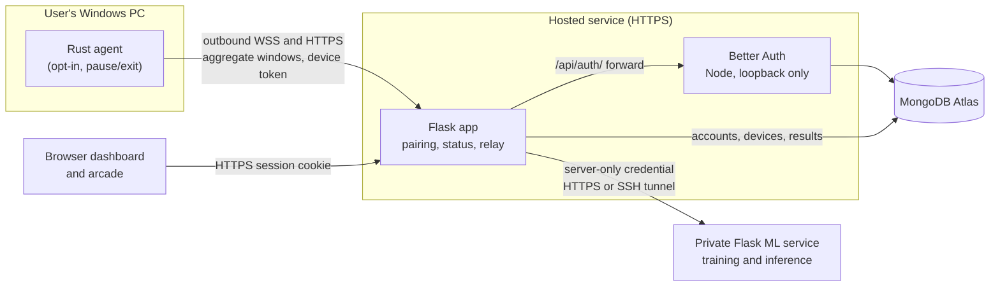

# Architecture decisions

This document resolves [issue #1](https://github.com/hack-the-nest-but-happier/Inquisitor/issues/1).
It supersedes the open stack options in sections 11 and 19 of the
[original project specification](../Inquisitor_Continuous_Behavioral_Authentication_Project_Spec.md).
These are implementation decisions, not claims that the integrations already work.

## Selected stack

| Area | Decision | Reason and source |
| --- | --- | --- |
| Windows agent | Rust, with native Windows keyboard and mouse input and a visible pause/exit control | The local client and system I/O are assigned to Rust in [#43](https://github.com/hack-the-nest-but-happier/Inquisitor/issues/43#issuecomment-6882866683) and [#46](https://github.com/hack-the-nest-but-happier/Inquisitor/issues/46#issuecomment-6882888019). |
| ML | Python 3.13+ with scikit-learn; logistic regression for the current labeled pilot | Fit on genuine and consenting second-user examples, then reuse the saved model. Training and inference run on the designated remote host. Isolation Forest artifacts remain compatible for comparison. Deployment identity stays in local configuration. |
| Website | Flask with Jinja templates and esbuild-bundled TypeScript, building on `Frontend/` | The team chose to stay with Flask. The existing `Frontend/` app already uses this stack, and it shares Python with the ML service. |
| Backend arrangement | Rust collector, hosted application backend, and private remote Flask ML service | The application backend owns user/device authorization and forwards aggregate windows to the remote model service using a server-only credential. |
| Database | MongoDB Atlas | [#44](https://github.com/hack-the-nest-but-happier/Inquisitor/issues/44#issuecomment-6882901927) selects Atlas. Use MongoDB collections rather than adding PostgreSQL or Drizzle. |
| Authentication | Better Auth email/password accounts and MongoDB sessions | Replaces the original provider decision in #45 at the user's request. A loopback Node service owns passwords and sessions; Flask retains account/device authorization and pairing. |
| Demo hosting | Hosted HTTPS application, Windows Rust client, and remote Python training/inference | Model requests use authenticated HTTPS or a protected SSH tunnel. No public model-service port is required. |
| Input scope | Keyboard and mouse in v1 | The team added mouse as a second v1 signal. The arcade collects it during calibration games and the Windows agent collects it during monitoring, using the same aggregate feature definitions. The Windows agent always sends keyboard and mouse together as schema-v4 aggregates, covered by its setup terms; hosted training uses the genuine-only `native-v4` profile. Controller signals are outside the v1 authentication model. |

The remote ML arrangement supersedes the initial local-model interpretation of
#42, #43, and #46. Rust owns system I/O and transport; Python owns model execution
on the designated remote host. Isolation Forest was the first implemented model;
the current labeled pilot uses the shared `tray-multimodal` logistic regression
on keyboard timing and mouse motion/click aggregates. It uses schema-v4 native
aggregates; earlier numeric weights are retired under `archive_models/`.
Its performance on other people is not established. Model selection uses complete
computer/session groups; selection CV must not be presented as an untouched final test.

## Component boundaries and data flow

Arrows show who opens each connection. Only aggregate numeric windows cross the
agent-to-hosted and hosted-to-ML boundaries. Nothing connects inbound to the PC.

1. The consenting user enables the visible Windows agent. Rust captures transient
   keyboard timing and, when mouse collection is enabled, mouse motion and click
   timing. It pairs events in memory and produces numeric feature windows. Key
   identity, absolute pointer coordinates, click targets, window titles, and ordered
   input events never enter persistence, logs, model requests, or network messages.
2. The application backend forwards authorized aggregate JSON requests to the
   private Flask service. Training and inference run remotely, and versioned model
   artifacts are associated with the authorized account/device. The Rust client
   does not launch Python or hold the model-service credential.
3. The user signs into the hosted Flask app through Better Auth and pairs the agent
   using a short-lived, single-use code. The agent receives a revocable,
   device-scoped credential; it never receives the web password.
4. The agent opens an authenticated outbound WSS connection to the hosted relay.
   The dashboard connects to the hosted service using its authenticated browser
   session. The relay routes device status, scores, and authorized control messages
   between the two connections.
5. The hosted service stores account identity mappings, devices, enrollment/model
   metadata, and authorized monitoring results in Atlas. Model artifacts remain on
   the remote ML host. Enrollment windows must be transferred for training; consent,
   retention, and deletion must cover that remote processing. The model service
   stores windows submitted to `POST /windows` so reset and deletion can remove
   them. A training request is not kept as a raw body beyond the saved model artifact.

The outbound connection is the implementation choice for #43's server-to-local
status channel. The hosted server sends messages through the agent's established
connection; it does not initiate a connection to a private PC address. Do not
require public inbound ports or expose the detector directly to the Internet.
The server must bind both connections to the same authorized account/device and
reject messages after revocation. If the agent disconnects, show offline status
rather than displaying stale scores as live results.

## Alternatives and integration cost

- All-in-one FastAPI would put HTTP, training, and inference in one Python
  process, reducing the Rust/Python boundary. It would change #43's chosen local
  Rust API and move model execution into the hosted backend if used centrally.
- SvelteKit was the original website choice. It would add a second server
  language alongside the Python ML service and replace the existing `Frontend/`
  Flask app. The team chose Flask instead. Model execution stays in the separate
  private Flask ML service, off both the website host and the Windows client.
- A Python-only agent would reduce language boundaries, while C#/.NET would offer
  another native Windows implementation. Neither matches the Rust client decision.
  No comparative capture benchmark is available in this repository.
- SQLite is suitable for the existing local arcade prototype but does not match
  the selected hosted database. PostgreSQL would follow the usual project
  preference, but the explicit Atlas decision takes precedence. Atlas credentials
  belong only on the hosted service, never in the browser or desktop client.
- Better Auth owns password hashing and account/session persistence in separate
  MongoDB collections. Flask forwards `/api/auth/` requests to a Node service on
  `127.0.0.1:3001` and validates cookies through its `get-session` endpoint.
  Keep both processes on the same host. Auth cookies remain HttpOnly and use Secure
  when `BETTER_AUTH_URL` is HTTPS. Email verification, password recovery, and social
  providers require additional configuration and are not enabled.
- A laptop-only demo would reduce hosted infrastructure but diverge from #46.
  An aggregate-only replay may be prepared as a clearly labeled fallback.

## Scope and existing prototype

The arcade games in `Frontend/` are the calibration surface. Their keyboard and
mouse gameplay produces aggregate calibration windows; controller gameplay does
not expand the authentication scope. Their local SQLite storage is not the hosted
Atlas store.

For v1, collect keyboard and mouse aggregates only, require explicit opt-in,
retain pause/exit controls, and never bypass the Windows secure desktop. An anomaly may request
application-level verification; it must not lock Windows. Enrollment and evaluation
must preserve session boundaries, and synthetic fixtures must not be presented as
evidence of model accuracy.

Security scenarios, response headers, and the endpoint owner checklist are in
[threat-model.md](threat-model.md).
Aggregate-only privacy boundaries are in [privacy.md](privacy.md).

## Implementation verification still required

- Prove Rust background input capture and timing quality on the target Windows PC.
- Verify live tray transport on a deployed host. The tray now pairs, holds the
  agent WebSocket, and uploads schema-v4 windows computed live with the same
  calculation as the CSV converter. That path passes a local end-to-end test
  against the hosted-mode routes (`scripts/agent_link_test_server.py`), not a
  deployed HTTPS/WSS host. Browser calibration compatibility remains unverified.
- Verify that browser pointer events and Windows mouse input give comparable
  aggregates. Their event sources and sampling differ, so arcade calibration windows
  may not match agent monitoring windows without per-source checks.
- Verify Python 3.13+ and the locked scikit-learn environment on the model host.
- Configure Better Auth's public origin and secret, start its Node service, and
  validate sign-up/sign-in/sign-out against Atlas with account isolation. Existing
  provider accounts are not automatically linked by email or migrated. Better Auth
  IDs are namespaced in application records to avoid identity collisions.
- Provision Atlas and test the hosted service connection using TLS and restricted
  database credentials. [Atlas connection documentation](https://www.mongodb.com/docs/atlas/driver-connection/)
  requires TLS-capable clients. No promotional credit or existing cluster is assumed.
- Deploy the chosen host, verify its HTTPS certificate and WSS upgrade, then test
  an authenticated agent-to-relay-to-dashboard round trip, disconnect, and revocation.
  The private model service has passed authenticated training/scoring and access
  checks through an SSH tunnel, including health after restart. The hosted
  application connection and HTTPS/WSS round trip are not verified yet.

These checks belong to implementation and deployment work. This document completes
the stack and scope decisions without claiming those checks have passed.
